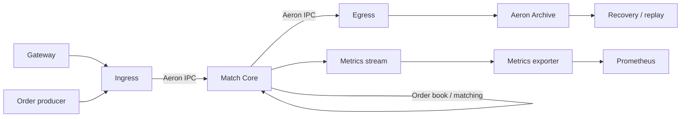

# open-cex-match

[](./LICENSE)
[](https://adoptium.net/)

一个用于**学习、研究和工程实践**的 Java 高性能撮合引擎。项目关注价格时间优先、
单线程确定性撮合、SBE 二进制协议、Aeron 低延迟传输、快照恢复以及主备高可用等
交易所核心基础设施问题。

> [!NOTE]
> **AI 辅助开发说明**：本工程大量使用了 AI 辅助编码，核心模块经过人工 review
> 和修改。

> [!WARNING]
> 本项目以学习撮合引擎原理和工程实践为出发点，**不得用于任何非法活动**。
> 包括但不限于市场操纵、虚假交易、欺诈、洗钱、规避监管、无牌经营证券、衍生品、
> 支付或其他受监管金融业务。使用者必须自行确保业务授权、合规、风控和审计要求。

> [!IMPORTANT]
> 本项目仍处于持续开发和验证阶段，尚未经过独立安全审计、合规认证或生产级灾备
> 验收。**不得将其默认为生产就绪系统，也不应在没有完整安全评估的情况下承载真实
> 资金或生产交易。**

## 项目定位

`open-cex-match` 是一个 headless、事件驱动的撮合域实现。它不负责账户、资金、
清算、行情服务或交易所完整营业体系，而聚焦以下问题：

- 订单如何以紧凑数据结构驻留内存；
- 如何在单 symbol、单线程模型下实现确定性的价格时间优先撮合；
- 如何通过 SBE 与 Aeron 降低编解码和数据传递开销；
- 如何利用快照、输入 journal 和回放恢复引擎状态；
- 如何验证主备切换、背压、故障恢复和可观测性设计。

## 设计理念：LMAX 与机械同理心

本项目的设计深受 **LMAX 交易架构**和 **Mechanical Sympathy（机械同理心）** 思想
影响。核心不是单纯增加线程，而是让软件结构顺应 CPU 缓存层次、内存访问、线程调度
和网络数据传输的物理特性，尽量缩短关键路径并减少不可控开销。

这些理念在代码中具体体现为：

- **单写者、确定性撮合**：每个交易对由单一撮合线程处理，以顺序执行换取可预测的
  状态变更和更低的同步成本。
- **面向缓存的数据布局**：订单簿、价格档位和条件单使用 SoA 与 primitive 数组，
  提高内存密度，减少对象遍历和缓存未命中。
- **关键路径控制分配**：预分配槽位、复用缓冲和固定容量数据结构，降低热路径上的
  对象分配、GC 与尾延迟。
- **顺序 I/O 与显式数据流**：通过 SBE 固定布局和 Aeron IPC/UDP 传递原始帧，
  减少无意义的编解码、复制和跨线程交接。
- **有界队列与背压**：用确定的容量和明确的反压路径代替无界堆积，让过载行为可观测、
  可推理。
- **隔离慢操作**：网络接入、出站编码、Archive 持久化和指标导出与撮合核心分离，
  避免磁盘或下游系统抖动直接污染撮合线程。

项目参考了 LMAX 等低延迟交易系统的公开架构理念，但与 LMAX Exchange 或其他
交易平台不存在隶属、授权或背书关系。

## 核心特性

- **价格时间优先订单簿**：单 symbol 单写入线程，便于复现和验证撮合顺序。
- **SoA 数据结构**：订单槽位、价格档位和条件单采用扁平 primitive 数组，减少对象
  分配和缓存跳转。
- **多类订单支持**：限价单、市价单、批量撤单和条件单等。
- **SBE 二进制协议**：提供 schema、固定布局测试和黄金帧兼容性验证。
- **Aeron 传输链路**：支持 UDP 入口与进程间 IPC 通信，连接网关、ingress、core
  和 egress。
- **快照与恢复**：快照分段、入站 journal 回放和成交对账构成恢复链路。
- **主备高可用实验**：包含热备、主备一致性、故障接管和 Raft 仲裁相关实现。
- **可观测性与压测**：独立 metrics sidecar、Prometheus 指标、JMH benchmark、
  端到端压测及故障演练脚本。

> 特性列表描述的是代码库覆盖范围，不代表这些能力已经达到生产部署标准。

## 性能成绩

项目在单机回环环境完成了从短时上限探测到 30 分钟长稳、超大压力成交对账的验证。
以下为 2026 年 8–9 月压测报告中的代表性记录，测试机为 10 核 Apple M4，交易对为
`BTCUSDT`；TPS 口径为订单帧注入速率，不等同于成交笔数。部分纪录早于当前
`orderIndex` 索引设计，复测可能略有差异。

| 场景 | 实测结果 | 稳定性与正确性 |
| --- | ---: | --- |
| 完整链路，录制 + 快照全开，30 分钟长跑 | **1.15M TPS 均值** | 20.84 亿帧；0 发送失败、0 过载、0 积压、0 Full GC；4,158 万容量拒绝 |
| 零落盘，当前 `orderIndex` 映射设计，300 秒（当前基线） | **3.89M TPS** | 相比此前 4.17–4.20M 基线约 5–7% 回退，用于换取业务 ID 与存储槽位解耦 |
| 完整链路，4M TPS × 600 秒历史记录 | **3,999,991 TPS** | 5.38 亿笔成交，0 失败、0 拒绝、0 积压；15M 订单簿，1 次 27ms Full GC |
| 5.5M TPS × 300 秒超大压力对账 | **4.248 亿帧 / 1.196 亿笔成交** | 全量回放 `RECON_PASS`，U1/U2/U4/U5 差异全部为 0 |
| bare-core 单撮合线程上限探测（历史极限） | **约 8.5M TPS** | 关闭磁盘持久化并使用预生成订单池，属于核心极限探测，不是完整链路成绩 |

测量环境、脚本参数、JFR/GC 数据和限制条件详见
[性能基线与压测报告](./docs/10-performance.md)、
[历史压测记录](./docs/12-stress-test-report.md) 和
[bench 模块](./ocx-match-bench/README.md)。这些数字是特定机器和特定负载下的
工程验证结果，不应直接外推为生产 SLA。

## 架构概览



核心设计是让撮合线程只处理内存状态和确定性业务逻辑，将网络接入、出站编码、
持久化和指标采集放到独立进程或线程中。更完整的拓扑、数据结构、恢复链路和参数
说明见 [架构文档](./docs/01-architecture.md) 与 [运行手册](./docs/11-runtime-runbook.md)。

## 目录导航

仓库由文档、Java 撮合模块、压测模块和 Rust producer 组成。目录职责如下：

| 目录或文件 | 内容与用途 |
| --- | --- |
| `README.md` | 项目介绍、快速开始、性能成绩和合规说明 |
| `LICENSE` | MIT 开源许可证 |
| `pom.xml` | Maven 聚合工程、Java 版本和依赖版本管理 |
| `docs/` | 从架构、数据结构到恢复、监控、性能和运行手册的完整文档 |
| `docs/diagrams/` | 类图、撮合时序图等 Mermaid 源文件 |
| `docs/imgs/` | 入簿、整体分层和恢复链路的 SVG 示意图 |
| `docs/viz/` | SoA 订单簿交互式讲解、Python 参考实现和浏览器测试 |
| `docs/viz/tests/` | 可视化操作步骤、断言用例和界面截图 |
| `ocx-codec/` | SBE schema、协议编解码、固定布局与黄金帧兼容性测试 |
| `ocx-match-core/` | 订单簿、撮合引擎、条件单、快照、恢复和 HA 核心 |
| `ocx-match-ingress/` | Aeron UDP 收单、帧校验、symbol 路由和入站发布 |
| `ocx-match-egress/` | 成交、深度和事件出站，以及 Aeron Archive 持久化集成 |
| `ocx-match-gateway/` | HTTP 订单入口、clientOrderId 映射、orderId 发号和端到端冒烟脚本 |
| `ocx-match-logging/` | 撮合域日志配置、纳秒时间戳、Trace 与敏感数据脱敏 |
| `ocx-metrics-exporter/` | 从 Aeron metrics 流导出 Prometheus 指标的 sidecar |
| `ocx-match-bench/` | JMH benchmark、JFR 基准脚本和整链性能观测工具 |
| `ocx-match-bench/scripts/` | 压测、主备切换、长稳测试、Raft 仲裁和磁盘采样脚本 |
| `ocx-stress-producer/` | Rust 编写的订单池 producer，用于高吞吐注入和协议对拍 |

Java 模块统一遵循 Maven 目录约定：

| 子目录 | 内容 |
| --- | --- |
| `src/main/java/` | 模块生产代码和进程入口 |
| `src/main/resources/` | YAML 配置、SBE schema、日志配置等运行资源 |
| `src/test/java/` | JUnit 单元测试和集成测试 |
| `src/test/resources/` | 黄金帧、固定测试数据等测试资源 |
| `target/` | 本机构建产物，已被 `.gitignore` 排除 |

Rust producer 的代码位于 `ocx-stress-producer/src/`，依赖锁定在
`ocx-stress-producer/Cargo.lock`。

## 环境要求

- JDK 21
- Maven 3.9+
- Rust stable（仅构建 `ocx-stress-producer` 时需要）
- Linux 或 macOS

低延迟绑核、内核参数和网络调优并非跨平台等价能力；相关配置应在目标机器上单独
验证。完整运行还涉及多 JVM、Aeron 媒体驱动目录和本地端口，建议先阅读运行手册。

## 构建与测试

```bash
git clone https://github.com/open-cex-repos/open-cex-match.git
cd open-cex-match

# 编译全部 Java 模块并运行测试
mvn -B -ntp clean test

# 运行 Rust producer 测试
cargo test --locked --manifest-path ocx-stress-producer/Cargo.toml
```

构建可执行产物：

```bash
mvn -B -ntp clean package
```

JMH benchmark 默认不进入主构建，需要显式启用：

```bash
mvn -B -ntp -Pbench -pl ocx-match-bench -am package -DskipTests
./ocx-match-bench/bench.sh -l
```

## 本地端到端演示

`gateway-smoke-test.sh` 会启动媒体驱动、Archive、egress、core、ingress 和网关，
验证 HTTP 下单、撮合、幂等映射与恢复。脚本需要本地 `java`、`mvn`、`cargo` 和
`bash`，并使用本机端口：

```bash
cargo build --release --locked \
  --manifest-path ocx-stress-producer/Cargo.toml
./ocx-match-gateway/gateway-smoke-test.sh
```

默认输出目录为 `/tmp/gateway-smoke`，HTTP 网关监听 `localhost:8080`。更多压测和
故障演练命令见 [bench 文档](./ocx-match-bench/README.md)。

## 文档

项目文档按依赖顺序组织，适合从撮合核心逐步阅读到恢复、运行和调优：

- [文档总览与阅读路径](./docs/README.md)
- [架构总览](./docs/01-architecture.md)
- [订单簿与数据结构](./docs/02-data-structure.md)
- [订单生命周期与撮合流程](./docs/03-order-lifecycle.md)
- [主备高可用](./docs/04-ha.md)
- [录制端解耦](./docs/05-recording-decoupling.md)
- [崩溃恢复](./docs/06-crash-recovery.md)
- [客户端恢复协议](./docs/07-client-recovery-protocol.md)
- [运行手册](./docs/11-runtime-runbook.md)
- [性能基线与压测报告](./docs/10-performance.md)

交互式订单簿演示位于
[`docs/viz/orderbook_soa.html`](./docs/viz/orderbook_soa.html)。

## 项目状态

- 当前版本为 pre-1.0，内部 API、配置键、协议 schema 和部署方式仍可能变化。
- 测试和压测结果只代表特定机器、配置和负载，不构成生产容量承诺。
- 安全、清算、风控、合规和监管义务不属于本项目自动提供的范围。

如果发现安全问题，请优先使用 GitHub 仓库的 Security Advisory 私下报告，避免在
公开 issue 中披露可直接利用的细节。

## 参与贡献

提交变更前请至少运行：

```bash
mvn -B -ntp test
cargo test --locked --manifest-path ocx-stress-producer/Cargo.toml
```

涉及撮合语义、协议字段或恢复流程的修改应同步补充测试与文档。提交信息建议使用
`feat:`、`fix:`、`refactor:`、`docs:`、`test:` 等清晰前缀。

## License

本项目采用 [MIT License](./LICENSE)。
