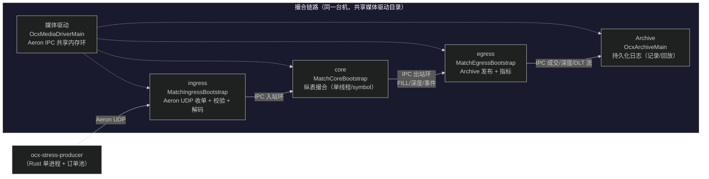
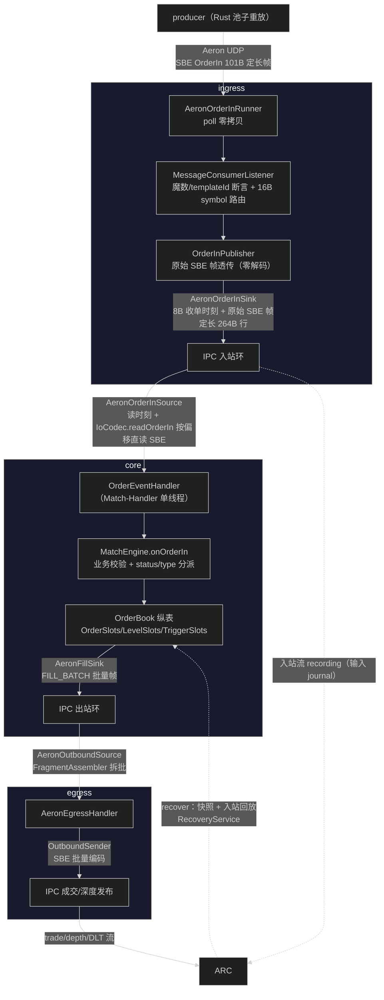
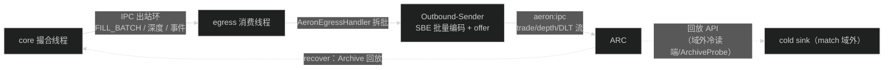
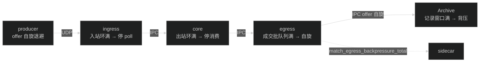

# 架构总览（五进程拓扑 / 数据流 / 出站 Archive / 背压容错）

> **本章解决**：撮合引擎是什么、五个进程如何协同、数据从收单到出站怎么流。
> **前置依赖**：无（全书起点）。
> **读者前置**：分布式系统基本概念（进程 / 消息 / 持久化）。

> 本文档只描述**当前架构**（2026-08-28：撮合链路完全脱离 Kafka，Aeron 全链路 +
> 纵表订单簿 + Aeron Archive 出站）。历史演进细节已删除，关键决策以 10-performance.md §3 时间线呈现。
> 运行/部署参数见 [运行手册](11-runtime-runbook.md)；
> 压测数据见 [可观测性压测报告](12-stress-test-report.md)。


## 1. 架构总览

### 1.1 定位与设计哲学

撮合引擎是一个 **headless、无业务日志、纯内存**的高性能订单簿：

- **headless**：不监听 HTTP、不连 MySQL/Redis/Consul/Kafka，入站只收 Aeron UDP，
  出站只写 Aeron Archive（本机磁盘）；
- **零业务日志**（`slf4j-nop`）：可观测性全部走 sidecar 指标 + 关键事件通道；
- **纵表（SoA）+ primitive 全程**：订单簿/条件单为扁平数组，撮合热路径零对象、
  零分配、零 GC；LMAX 机械同理心——把软件映射到硬件（缓存行、预取、绑核）；
- **单 symbol 单线程撮合**：每交易对一个撮合线程，无锁确定性，价格-时间优先。

### 1.2 五进程拓扑

生产形态为**四个独立业务进程 + 一个共享媒体驱动**（`stress-test.sh --big` 自动编排）：



进程职责：

| 进程 | 主类 | 职责 |
| --- | --- | --- |
| media driver | `OcxMediaDriverMain` | 共享 Aeron IPC 媒体驱动（所有跨进程传输走共享内存） |
| ingress | `MatchIngressBootstrap` | UDP 收单 → 帧级校验 → symbol 路由 → 原始帧透传 → 入站环 |
| core | `MatchCoreBootstrap` | 纵表撮合：校验/入簿/撮合/撤单/条件单（零 SBE、零磁盘、零持久化） |
| egress | `MatchEgressBootstrap` | 出站环消费 → SBE 编码 → Archive 发布 → 指标队列 |
| archive | `OcxArchiveMain` | 记录入站 journal / 成交 / 深度 / DLT 流到磁盘，可回放 |

### 1.3 端到端数据流



### 1.4 关键架构决策（2026-08 系列）

| 决策 | 内容 | 动机 |
| --- | --- | --- |
| 入站 Aeron UDP | 客户端/压测端直发 SBE 帧进 ingress，替代 Kafka 收单 | 主流交易所收单用 Aeron，链路成本降 92%（10-performance.md §1） |
| 出站 Aeron Archive | egress 只写 Archive 持久化日志，替代 Kafka 出站 | Bitvavo cold-log：撮合不碰下游慢系统，Kafka 由域外冷读端消费 |
| 入站 journal（替代状态变更 WAL） | 崩溃恢复唯一事实来源 = 入站流 recording：`OcxArchiveMain` 持续记录 `inbound(symbol)`，恢复 = 快照 + 锚点后回放入站帧重跑撮合；archiveWal 状态变更流 **2026-08-29 已整体退役**（历史 recording 仅审计，`StreamIds.archiveWal` 常量保留防流号复用） | 对齐 Aeron/LMAX「journal 输入而非内部状态变更」；同一录制设施同时承担出站日志与恢复，不再维护第二套状态变更日志（06-crash-recovery.md §1） |
| 录制端落盘 = 长跑天花板（2026-08-30 归因） | 入站 recording 的持续落盘（~0.5GB/s @1.6M TPS）+ 页缓存累积是完整形态长跑吞吐与衰减的主因：600s 基线 1.60M 均值（3.7M→1.6M 衰减）；关录制对照 4.47M 平线 300s（+2.8x，触到完整形态上限）；关快照仅 +12%；快照后段回收同时承担磁盘水位（关快照 300s 即留 175GB） | 生产持续吞吐要逼近 ~4.4M 需把录制落盘搬出主盘（独立介质/分 symbol 分盘）或录制降频，见 10-performance.md §1.9 |
| 纵表 SoA | 订单簿/条件单全部扁平数组，primitive 全程 | 缓存密度、零 GC、可整体 mmap；5M 簿常驻 ~650MB |
| 单进程池子注入 | Rust producer 预生成订单池，热路径只改 ID | 注入端零生成开销，不污染引擎观测 |
| 入站 SBE 帧透传 | ingress 只做校验 + symbol 路由（int 索引直取槽位），原始 SBE 帧 + 8B 时刻原样进 IPC，core 按偏移直读 | 消灭"解码→再编码→再解码"往返；ingress 从 96.7% 饱和降到总采样 9.7%（对齐 CoinTossX/LMAX：网关只路由，撮合零拷贝直读） |
| 快照 + 锚点回放 | 快照 = 完整应用状态（簿 + 条件单），快照流由 **Archive 常驻录制**，每张快照 = `BEGIN(seq)+META+ORDER+STOP+END` 分段（2026-08-31 方案 A，替代每张 start/stop recording），META 携带入站 recordingId+position 锚点；恢复 = 回放最新有效快照段预填 + 锚点后增量回放入站帧 | 快照把回放起点前推到锚点，避免全量重放；快照与入站 journal 共用同一套 Archive recording/回放设施（06-crash-recovery.md §1） |
| 撮合线程 idle=backoff（默认） | 自旋为主、偶发让核 | 共享核场景避免掉队空转抢核（700K 实测） |
| 出站背压自旋不丢数据 | core/egress 对 Archive offer 失败自旋重试 + 计数 | 无 outbox、无丢事件，背压只停留在发送线程 |
| core 压测堆 4g | 固定堆 + AlwaysPreTouch | 纵表 5M 簿峰值 ~1GB，4G 余量充足，缓解整机内存压力 |

---

### 1.5 明确不采纳 / 架构边界（2026-08-30 审计）

以下刻意不"彻底 Aeron 化"，避免被误读为缺口：

| 项 | 现状 | 理由 |
| --- | --- | --- |
| Aeron Cluster | 未采用（无 Cluster 依赖） | 单节点、无共识/选主需求；快照/日志仅"对齐其规范"（BEGIN/END marker、快照 recording + 日志锚点），不引入 Cluster 运行时 |
| HTTP | 仅 sidecar（`:9201/metrics`） | Prometheus 抓取边界；引擎本身 headless（无 Tomcat/无入站 HTTP） |
| metrics 流加录 Archive | 不加录 | 观测层 = sidecar 活订阅 + Prometheus 持久化；metrics 不参与恢复语义。高保真历史/事件明细需求出现时再加（OcxArchiveMain 一行 + sidecar replay 模式） |
| 进程内数据交接 | egress 内 agrona SPSC/MPSC 队列 | 进程内交接用 agrona 正确（无 IPC 序列化开销）；跨进程才走 Aeron IPC |
| 配置分发 | bootstrap 阶段 system properties/YAML，单实例同源（脚本 ENG_CFG 一份） | 配置是启动前输入，非 Aeron 域（Aeron 无配置面）；多 symbol/多实例前收敛为共享配置制品 + 可选审计 recording |
| 控制流 | READY/GO 走 Aeron 控制流（2026-08-30），脚本侧 `StressControl` 等待 | 编排与引擎信号统一到 Aeron；控制流仅承载启动信号，不承载业务数据 |

---
## 2. 出站：Aeron Archive（Bitvavo cold-log）

### 2.1 出站链路



对齐 Bitvavo：**撮合热路径只写 Archive 持久化日志，下游慢系统由冷读端消费**；
我们更进一步——match 域不保留 Kafka，Archive 就是出站事件与恢复（入站 journal）的
最终出口。

### 2.2 流布局与帧格式

- 流 ID：`StreamIds.archiveTrade(symbol)` / `archiveDepth(symbol)`（IPC 200k+ 区间），
  DLT 全局流 `ARCHIVE_DLT_STREAM`，恢复回放流 `walReplay(symbol)`（410k 区间）；
  `StreamIds.archiveWal` 常量保留（历史 recording 审计，防流号复用），不再有发布者；
- 成交：SBE 批量帧 `[len][frame]` 连续拼接，一条 Aeron 消息携带 1~N 笔（最多 512）；
- 深度：SBE `DepthSnapshot` 全量帧（每批发布，节流默认 500ms）；
- DLT：异常/脏数据帧（ingress 或 core 侧），低频；
- `OcxArchiveMain` 记录订阅先于发布注册，数据不丢；发布方（core/egress）感知不到 Archive。

### 2.3 落盘验证与冷读

- `ArchiveProbe`：列出全部 recording（stream/字节/位置），可回放成交流按帧计数，
  压测脚本在停 egress 后自动与 `match_trades_total` 对照；
- `RecoveryMain`（`--wal-recover-check`）：压测停 core 前从入站 recording 回放
  验证恢复（快照预填 + 增量重跑撮合，06-crash-recovery.md §1.4）；RecoveryService 与冷读端复用同一套
  replay API；
- 未来 match 域之外的冷读端复用同一套回放 API，把成交/深度/DLT 喂下游
  （Kafka/MySQL/清算），ArchiveProbe 已示范。

---
## 3. 背压与容错

### 3.1 背压链



全链路有界队列 + 显式背压，**不丢数据**：背压只停留在发送线程与各环节的有界环上，
不进入撮合主线程；`match_outbound_backpressure_total`（core→egress 环）与
`match_egress_backpressure_total`（egress→Archive）双通道观测；archiveWal 退役后
撮合线程不再有第二条持久化发布路径（状态变更日志发布已整体删除）。

### 3.2 五层防护

```mermaid
%%{init: {'theme': 'dark', 'themeVariables': {'clusterBkg': '#1a1a2e', 'clusterBorder': '#444'}}}%%
graph TD
    A["订单（Aeron UDP 进入）"] --> B1["L1 入参校验（ingress 帧级 + core 业务级）"]
    B1 -->|失败| X1["Archive DLT 死信流"]
    B1 -->|通过| B2["L2 幂等去重（槽位占用判重：同 id 重复 / 他 id 冲突）"]
    B2 -->|重复| X2["拒绝"]
    B2 -->|新单| B3["L3 用户级流控（本地令牌桶）"]
    B3 -->|超限| X3["丢弃 + 事件"]
    B3 -->|放行| B4["L4 STP 自成交防护（同用户不与自己成交）"]
    B4 -->|通过| B5["L5 事后一致性（快照 + 入站回放校验 + 指标观测）"]
    B5 --> C["撮合完成"]
```

### 3.3 DLT 与关键事件

- 异常/脏数据帧进 Archive DLT 流（撮合链路已无 Kafka）；
- 关键信号（快照/恢复失败、出站发布失败、Archive 背压、DLT 失败等）经事件通道写入
  metrics 队列，sidecar 暴露为 `match_engine_events_total`（1s 限流防洪峰）。

---
## 附：文档索引

- 运行手册：[match-engine-runtime-runbook.md](11-runtime-runbook.md)
- 压测报告：[observability-stress-test-report.md](12-stress-test-report.md)
- orderId 设计：02-data-structure.md 02-data-structure.md §1.9
- Grafana 面板：`open-cex-ops/dashboards/撮合引擎.json`

