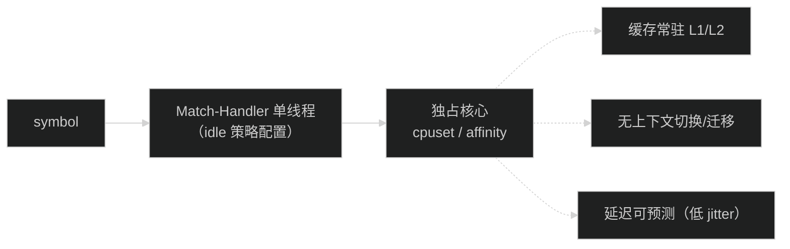

# 核心数据结构（纵表 SoA）

> **本章解决**：订单在内存里怎么「住」（纵表 SoA）、orderId 怎么发号、价格档怎么组织。
> **前置依赖**：01（架构里引入纵表 / 五进程）。
> **读者前置**：数组 / 哈希 / 定点数。

## 1. 核心数据结构（纵表 SoA）

### 1.1 为什么纵表

订单簿/条件单的在簿状态从"对象图"改为**扁平数组（SoA）**：每列一个
`long[]/int[]/byte[]`，槽位索引即"指针"。收益：

- **缓存行密度**：同列顺序访问命中硬件预取；4B int 索引取代对象引用，同缓存行可装
  2 倍节点；
- **零 GC 扫描**：数组里的 int 索引不是引用，GC 不追踪；常驻数组构造期预分配；
- **零分配热路径**：槽位 freelist 复用，撮合/出站全程无对象构造；
- **可整体 mmap/序列化**：整块数组可直接落盘（快照/恢复的 Frozen 红利）。

实测：5M 在簿常驻约 **650MB**，长跑 **0 Full GC**。

### 1.2 OrderSlots（在簿订单槽位）

```java
public final long[] orderIds, userIds, prices, origQtys, execQtys,
                   cumQuoteQtys, visibleQtys, displayedQtys, times;
public final int[]  next, prev;      // 同价 FIFO 链 + freelist 复用
public final int[]  levels;          // 所在价格档位（LevelSlots 索引，-1=未挂载）
public final byte[] flags;           // 方向 1bit / TIF 2bit / 冰山 / 在簿标记
```

- 价格/数量为定点 `long`（coinScale/baseCoinScale），撮合纯整数运算；
- 槽位由簿内 freelist 分配（`next[]` 空闲时复用为链指针），orderId→槽位经
  `orderIndex`（Long2IntMap）映射（见 §1.3，2026-09-01 续）；
  `orderIds[slot] == 0` 表示空槽；
- FIFO 链：同价档尾追加（时间优先），`prev` 支持 O(1) 撤单摘除；
- `levels[]` 档位列：入簿记录档位，撤单/成交摘除直接读列，省 `price→level` 哈希；
- `flags` 位压缩：方向（0=买 1=卖，对齐业界惯例）、TIF、冰山、在簿。

### 1.3 orderId 编码规则（Snowflake 化纯业务号 + orderId→slot 映射）

2026-08-29 曾把槽位内嵌进 orderId（`slot = id & SLOT_MASK` 零哈希直定位）；
2026-08-31 升级三段式发号、2026-09-01 升级 Snowflake 化（高位时间驱动）。
**2026-09-01 续：复盘发现"ID 即存储地址"把业务唯一键与物理位置耦合，产生
槽位回绕冲突税（拒绝率 ≈ e^(-CAP/N)），且 orderId 无法由发号方自由分配——
决定回退为 orderId→slot 映射 + 槽位 freelist**（引擎 `OrderBook.orderIndex`
为 Long2IntMap）。布局保留 Snowflake **纯业务号**，物理落位由引擎内部负责。
**完整设计（碰撞域分析、位宽推导、发号方职责、Aeron 取舍与迁移路径）见
02-data-structure.md §1.9**；本节只保留引擎热路径必须
遵守的规则：

```
orderId = (seg << 42) | (发号方ID << 34) | counter   // 纯业务号，不内嵌槽位
seg     = 自 1970 起的小时数（21 位，单调不减：时钟回拨取 max、段内耗尽提前推进）
slot    = orderIndex.get(orderId)                    // 引擎内部映射，O(1) 一次哈希
```

**位宽与硬约束（2026-09-01 续 定）**

- `COUNTER_BITS = 34`：段内序号位宽（与引擎槽位无关）；`SEG_BITS = 21` +
  `发号方ID 8` 位（1..255）→ 总位宽 21+8+34=63，不越 i64 正数域；
- 发号方 ID 部署内唯一（压测 = `ocx-stress-producer --instance-id`，脚本自动分配
  1..N）；发号方 ID 非零 → `id=0` 天然不可达（入站校验仍显式拒绝 id=0）；
- 跨发号方无需协作：高位不同即全局唯一；同发号方跨重启由时间段 + 持久化
  (seg, counter) 水位保证（生产网关 `OrderIdAllocator` 已落地；压测场景
  Archive 清档无历史单，依赖时间隔离）。
- **容量**：每 (发号方, seg) 段内 2^34 ≈ 171.8 亿单；段随自然时间/耗量提前
  推进，永不耗尽（见 02-data-structure.md §1.9）。

**容量与掩码（硬约束）**

- 槽位数组容量强制 2 的幂（`nextPowerOfTwo`）：cap=5,000,000 → `CAP = 2^23 =
  8,388,608`；**在簿上限 = min(maxOpenOrders, 槽位数)**——槽位由 freelist
  分配，拒绝只发生在簿真正满时（`order_book_cap_reject` 可观测），
  不再有"轮转槽位冲突税"；
- 内存：OrderSlots 常驻 ≈ 713MB（@2^23）+ orderIndex（Long2IntMap，@5M
  ≈ 100MB）+ LevelSlots/TriggerSlots ≈ 1.06GB/交易对。

**引擎侧规则（撮合线程内全部 O(1)）**

| 操作 | 定位 | 校验/语义 |
| --- | --- | --- |
| 入簿 | `orderIndex.get` 判重 → `slots.alloc()` freelist | 重复 rc=2（判重提前到撮合前）；槽位耗尽/cap rc=1 |
| 撤单 | `orderIndex.get(orderId)` | 命中且 `orderIds[slot] == orderId` 才摘除；否则幂等未命中 |
| 成交摘除 | 撮合链上直持 slot，不经过 id | 无校验（链即权威）；`releaseSlot` 归还 freelist + 摘映射 |
| 入站回放 | 同入簿/撤单（freelist 分配确定性） | 重放布局与崩溃前一致，无需分配器 |

**发号方职责（写给网关 / 接入方）**

- **生产** = 网关换发 `exchangeOrderId`（已落地：ocx-match-gateway
  `OrderIdAllocator`，与本节规则一致）；**压测** = `ocx-stress-producer
  --instance-id N`（每进程独立 ID + 当前小时段）；
- 真实客户端 `clientOrderId` 与簿内 orderId 是两个空间：由网关按本规则换发
  `exchangeOrderId`（幂等映射与恢复协议见 docs/20）；
- 条件单（TriggerSlots）v1 保留自身 orderIndex（§1.6），触发转单入簿走同一
  orderIndex 映射。

> **接入约束**：任何新接入方不得把任意 `clientOrderId` 直接塞进 `OrderIn.id`——
> 接入前必须先经网关换发（否则判重/归属错乱）。

**代价与收益**

- 代价：入簿/撤单/回放每次一次 `Long2IntMap` get/put/remove（预估几个百分点
  吞吐，需复测）；orderIndex 常驻内存 @5M ≈ 100MB；
- 收益：orderId 回归纯业务号、发号方自由分配；**槽位轮转冲突税归零**（5M
  在簿语义干净，不再有 e^(-CAP/N) 隐性拒绝）；判重提前到撮合前（旧实现在
  挂单路径才判重，重复单可能二次成交）。

### 1.4 LevelSlots（价格档纵表 + 数组跳表）

```java
public final long[] prices;                 // 定点价
public final int[]  heads, tails, counts;   // 档内 FIFO 头尾 + 订单数
public final long[] normalRemaining;        // 普通单剩余量聚合（深度 O(1) 读取）
public final long[] icebergDisplayed;       // 冰山显示量聚合（隐藏量不计深度）
public final int[][] next;                  // next[level][slot]：数组化跳表指针
```

- 数组化跳表：`next[level][slot]` 存 int 档位索引而非对象引用；BUY 簿降序、SELL 簿升序，
  `firstLevel()` 即最优档；
- 最近访问缓存（`Long2IntMap` 65536 槽）：`getOrCreate` 命中 O(1)，失配才走跳表；
- 触发扫描 O(1) 预检：每张表维护最大 sortKey，价格未跨过任何触发边界时整表跳过；
- 聚合量前置：深度 = `normalRemaining + icebergDisplayed`，重建 O(档数)；
- FIFO 操作（append/unlink/moveToTail）支持外部 next/prev 数组（OrderSlots/TriggerSlots 通用）。

### 1.5 Long2IntMap（long→int 开地址哈希）

撮合簿的 `orderId→slot` 哈希（`OrderBook.orderIndex`）为**热路径主索引**
（2026-09-01 续 恢复，替代 08-29 的槽位内嵌——内嵌方案产生槽位回绕冲突税，
已回退）；同时供 LevelSlots 档位缓存、TriggerSlots 条件单索引等旁路使用：

- 线性探测 + 删除向后 rehash（无墓碑），长时间高负载不劣化；
- value 是 4B 槽位索引，缓存行密度翻倍、GC 零扫描；
- `tryPut()` 满时返回 false（缓存场景零异常开销）。

保留用途：LevelSlots 最近访问缓存（65536 槽，`getOrCreate` 命中加速）；
TriggerSlots 条件单 `orderId→slot` 索引（触发/撤单定位，v1 保留，见 §1.3）。

### 1.6 TriggerSlots（条件单纵表）

条件单（STOP/TAKE_PROFIT/TRAILING）同构纵表化：触发价/限价/数量/方向/类型列 +
按 (triggerType, direction) 分 8 张 `LevelSlots` 触发价索引 + TRAILING 单链 +
`orderId→slot` 索引。触发检查整档判定、槽位摘除保留、调用方读字段转单后 `release()` 归还。

### 1.7 撮合语义的纵表实现

- **价格-时间优先**：档内 FIFO，撮合从对侧最优档头逐单吃；
- **冰山**：`displayedQty` 列 + 档聚合，显示量吃穿且 taker 耗尽时刷新回队尾；
- **批量撤单**：按 userId 遍历挂单，O(挂单数)；
- **cap 拒绝**：`isFull()` 硬闸在入簿最前（内存保护）；
- **撮合主循环**：`matchTaker` 在数组列上整数运算，maker 完成自动摘链还槽。

### 1.8 CPU 亲和与 idle 策略

- 每 symbol 一个撮合线程，意图是**独占一个物理核**（OpenHFT Affinity，Linux 生效；
  macOS 无 `sched_setaffinity`，自动降级为普通线程）；
- 容器/cpuset 场景必须用 `-Daffinity.reserved=<hex>` 收敛选核池，否则可能选到 cpuset
  外的核导致启动即抛 `IllegalStateException`；
- 撮合线程 idle 策略 `-Docx.match.idle-strategy`（默认 `backoff`）：

| 策略 | 行为 | 适用 |
| --- | --- | --- |
| `backoff`（默认） | 激进自旋 + 偶发让核 | 共享核（macOS） |
| `busy-spin` | 纯自旋，空闲占核 | 独占核/Linux 绑核（LMAX 标准） |
| `yielding` / `sleeping` | 让核 / 固定毫秒睡眠 | 省 CPU 场景 |



---
### 1.9 orderId 完整设计（碰撞域 / 位布局 / 发号方职责）

本节为 §1.3 的完整设计展开，回答「为什么这样编码、边界在哪」。

**设计目标**：orderId 是撮合域唯一业务键，贯穿入站判重、撤单引用、成交归属、对账
（U2/U4/U5）、快照与确定性回放。须满足：全局唯一、发号方自由分配（不感知槽位）、
跨重启不撞历史单、热路径代价可控（一次 O(1) 哈希）、确定性回放、不越 i64 正数域、
永不耗尽。

**碰撞域分析**：

| 风险点 | 碰撞域 | 后果 | 防护 |
| --- | --- | --- | --- |
| 同 id 重复入站 | 全簿 | 同号二次成交 | 撮合前判重（orderIndex O(1)） |
| 多发号方发相同 id | 发号方之间 | 后到者被误拒 | 高位发号方 ID |
| 重启后基址重复 | 同发号方跨运行期 | 旧撤单命中新单 | 单调时间段 + 持久化水位 |
| 下游按 id 聚合 | 跨簿/跨实例 | 归属错乱 | 全局唯一 |

关键认知：唯一性与槽位是两个正交问题——唯一性由发号方高位保证，物理落位由引擎
freelist + 映射负责。

**位宽推导**：counter 34 位按段重置，段内耗尽提前推进一段并从 1 重发（高位单调，
永不撞历史段）；一段填满需 `2^34/TPS`，压测 1.4M TPS → 3.4 小时/段 → 约 808 年
耗尽段空间，实际永不耗尽。与经典 Snowflake（41 位毫秒 + 12 位序列）差异：我们用
21 位小时段 + 34 位计数，计数区更大、段更长。

**为什么不再内嵌槽位（v1.2 决策）**：08-29 曾把槽位内嵌进 id（`slot = id & SLOT_MASK`
零哈希直定位），但有两缺陷：①槽位回绕冲突税——counter 每 2^23 单回绕，上一代同槽
单仍存活则新单按 cap 拒绝，拒绝率 ≈ `e^(-CAP/N)`（N=1M→0.02%、3M→6%、5M→19%）；
②发号方无法自由分配。09-01 回退为映射 + freelist，orderId 回归纯业务号，热路径一次
O(1) 哈希、代价预估几个百分点吞吐（需复测）。

**发号方职责**：发号方 ID 部署内唯一（压测 `--instance-id` 自动分配 1..N，生产网关
`OrderIdAllocator` 持久化 (seg, counter) 水位）；id=0 不可达；跨发号方无需协作；
`clientOrderId` 与簿内 orderId 两空间，由网关换发，接入方不得把任意 clientOrderId
直接塞进 `OrderIn.id`。

### 1.10 档位与价格精度（tick size）

盘口「档」= 一个精确价格点上的全部挂单队列；市场能出现多少档由最小报价单位
（tick size）决定。引擎内部用 8 位定点 long（`coin-scale=8`，10⁻⁸ 粒度）表达价格，
纯整数运算；tick 是产品层的「允许出现的价格网格」，与撮合数据结构无关。

**两个易混的精度**：表达精度（引擎存储粒度，coinScale=8）vs 可报价粒度（tick size，
每个 symbol 一条规则）。`tick=0.01` 在 10⁻⁸ 坐标系 = 10⁶ 个网格单位，只是产品步长。

**业界**：Binance/Bitvavo 按 symbol 下发 `tickSize`+`stepSize`，服务端校验价格是 tick
倍数；美股 Reg NMS 禁止 sub-penny；期货按合约定最小变动价位。tick 过小→档位爆炸/
流动性摊碎，过大→价差变宽，几乎没有交易所对所有交易对用同一 tick。

**我们的做法**：每价一档 + FIFO + 跳表索引（历史对照：纯价格网格/"网格+链表"在 70%
撤单稀疏负载下退化 758K/2.03M vs 跳表 4.29M，最终「网格只做命中缓存、跳表兜底有序
索引」）；价格 8 位定点 long；tick/step 是配置非结构。**现状如实说**：入站校验只查
价格>0，不强制 tick 倍数，报价合规依赖网关/接入方——上生产前建议把 tick 校验提升为
服务端强制（参照 Bitvavo）。

## 2. 实现详解与常见误解

**关键机制**：

- SoA 缓存密度：同字段同数组连续存放，硬件预取友好；4B int 索引替代对象引用；
- 零 GC 扫描：数组元素是 primitive，GC 不追踪，长跑 0 Full GC；
- 确定性回收：freelist 按确定性顺序分配/回收，崩溃恢复回放后布局与崩溃前一致；
- Long2IntMap 墓碑 + 就地重建：删除置墓碑，墓碑超容量 1/4 触发就地重建；满时 `tryPut` 返回 false；
- 快照紧凑拷贝：`snapshotOrders` 零分配拷入 SnapshotFreeze。

**常见误解**：

- 误解：orderId 就是数组下标，撤单 = `arr[id]` 直接摘。
  实际：08-29 曾内嵌槽位，复盘发现「ID 即存储地址」耦合产生回绕冲突税且发号方失去
  自由分配，09-01 已回退为映射 + freelist（§1.3）。
- 误解：那么多数组（long/int/byte 混编），5M 单会占好几 GB。
  实际：primitive + 4B 索引密度高，5M 档在簿常驻约 650MB、0 Full GC；容量 2 的幂预分配。
- 误解：撮合引擎「价格精度 8 位」= 允许 8 位小数报价。
  实际：8 位是内部表达网格，真正可报价由 tick 决定，且当前不在热路径强制 tick 倍数。

## 3. 可执行验证

```bash
# 原子热路径成本（JMH，ocx-match-bench 模块根执行）
cd ocx-match-bench
./bench.sh OrderBookBench.marketTaker     # 市价 taker 吃单主循环
./bench.sh OrderBookBench.cancelReadd     # 撤单 + 同价回补
./bench.sh OrderBookBench.stressMix70     # 70% 撤单 + 30% 新增限价混合
```

代码锚点：`com.ocx.book`（OrderSlots / LevelSlots / TriggerSlots / Long2IntMap /
OrderBook）、`MatchEngineProperties.CoinScale`、`OrderIdAllocator`（网关）、
`ocx-stress-producer`（`--tick` 量化 + orderId 发号）。


