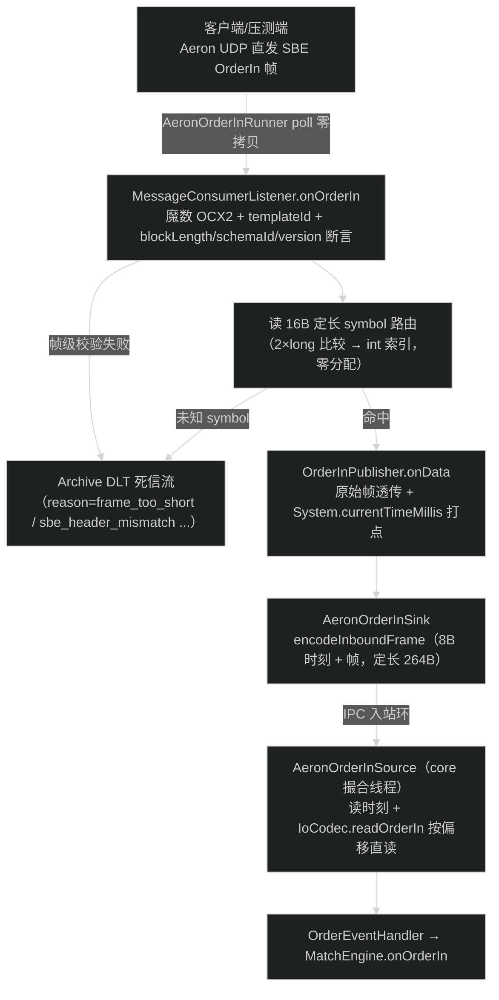
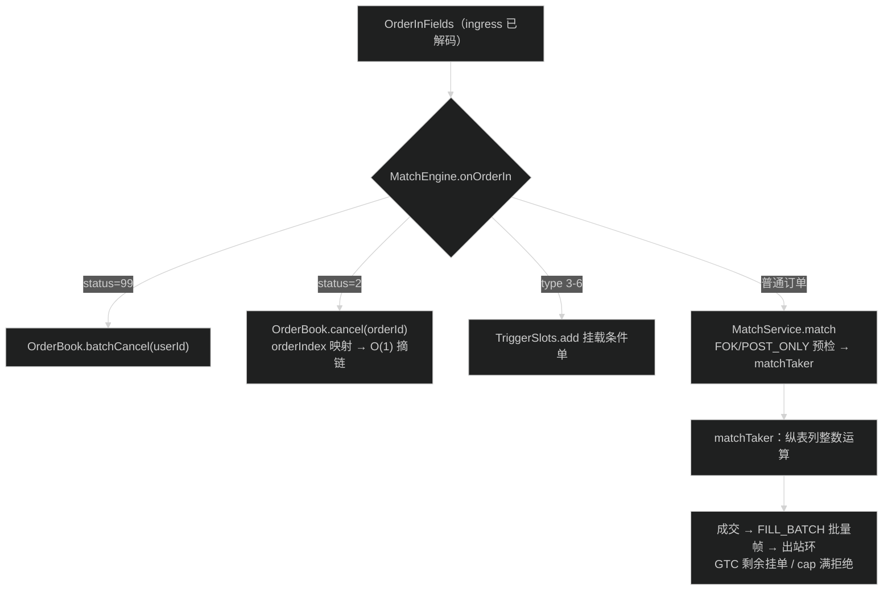
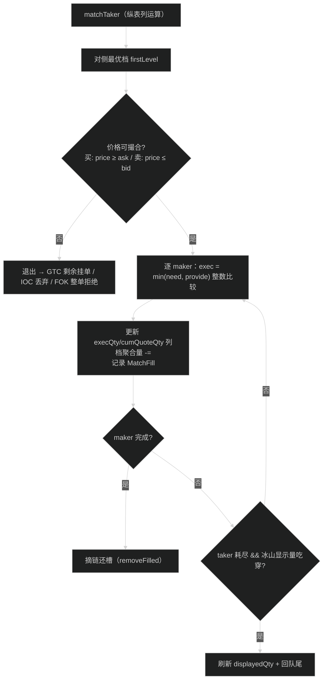
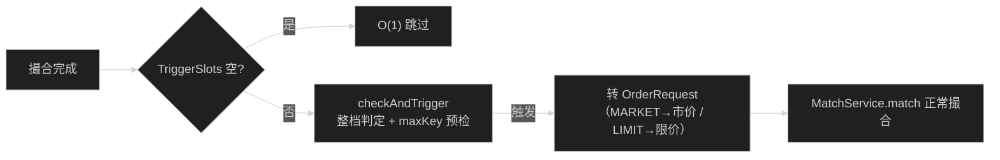

# 订单生命周期与撮合

> **本章解决**：一笔订单从收单到成交/挂簿的完整路径，撮合主循环如何逐档吃单。
> **前置依赖**：02（撮合直接操作纵表）。
> **读者前置**：价格-时间优先、TIF 语义。

## 1. 订单生命周期

### 1.1 ingress：Aeron UDP 收单

ingress 的 `AeronOrderInRunner` 轮询 UDP 订阅（默认 `0.0.0.0:11000`，每 symbol 一流，
流 ID = `StreamIds.inbound(symbol)`），做**帧级校验 + symbol 路由 + 原始 SBE 帧透传**
（2026-08-28 起不再解码/再编码），把 `[8B 收单时刻 + 原始 SBE 帧]` 定长 264B 行经
IPC 入站环交给 core——core 撮合线程按偏移**零拷贝直读**：



> 设计对齐 CoinTossX / LMAX：网关只做校验与路由，**不转换协议格式**；撮合核心
> 直读原始 SBE 帧（`IoCodec.readOrderIn` 定长字段按偏移解析，零 String/Decimal）。
> 原"ingress 解码成字段 → 再编码 IPC 行 → core 再解码"的往返已删除（JFR 实测
> decode + copyMemory 占 ingress 采样 52%，透传后 ingress 总采样占比降到 9.7%）。

**wire 契约（帧 = 应用信封 + SBE）**：

- 帧布局 = 4B 魔数（入站 `OCX2` / WAL-快照负载 `OCX1` / 快照信封 `SNP1`）+
  SBE MessageHeader（blockLength/templateId/schemaId/version 各 u16）+ SBE 消息体；
  魔数与帧长/填充属应用层信封，不属于 SBE 规范——仓外客户端按 SBE 对接时必须
  先剥信封；
- 字节序 little-endian（SBE 规范默认）；跨语言直读必须显式使用生成码
  `BYTE_ORDER`（agrona 无 order 参数的重载是 native 字节序，仅 x86/ARM 碰巧为
  小端，不可隐式依赖）；
- schema 版本纪律：只允许**消息尾部追加字段**，wire 变更必须递增 messageSchema
  `version`/`semanticVersion`，并同步 Rust producer（当前 io/wal = version 1）；
  解码一律按 `header.blockLength()/version()` wrap，旧版本帧仍可被新消费者读取
  （`SbeCompatibilityTest` 钉死该语义）；
- 双端黄金帧对拍：`ocx-codec/src/test/resources/sbe-golden/orderin-*.hex` 由 Java
  `mvn test` 与 Rust `cargo test`（ocx-stress-producer）共同断言——任意 CI 挂上
  两条命令即可防 Java/Rust 编码漂移（含 schema 版本与字段偏移变更）。

### 1.2 core：路由与撮合主流程



`OrderEventHandler.onEvent` 在批末触发：`publishDepthSnapshot`（深度帧进出站环）。
持久化与恢复不挂在撮合线程（见 06-crash-recovery.md §1：Archive 记录入站 journal，恢复 = 快照 + 回放）。

**入站解码（2026-08-29 按类型解码）**：`IoCodec.readOrderIn` 先读 `status`@71，
`status=2`（撤单）/`99`（批撤）只解 `id`+`userId`，其余字段归零；普通订单按
固定偏移 LITTLE_ENDIAN 直读（`getLong/getByte` 替代 SBE accessor/Decimal 封装，
热循环内联）。`MatchEngine.validate` 与之对齐：批撤只校验 userId、撤单只校验
id≠0。JFR 对比：解码段采样 37.7%→28.7%（10-performance.md §1.6）。

### 1.3 入簿（addOrderInternal）

```java
if (req.price <= 0) return 3;
if (isFull()) return 1;                     // cap 硬闸（内存保护，最前）
if (orderIndex.get(req.orderId) != -1) return 2;  // 判重（撮合前预检）
int slot = slots.alloc();                   // freelist 分配（O(1)）
if (slot == -1) return 1;                   // 槽位耗尽（簿真正满）
// 写入槽位列 + orderIndex.put(orderId, slot)
int level = levels.getOrCreate(req.price);  // 缓存命中 O(1) / 跳表 O(log 档)
slots.levels[slot] = level;                 // 记录所在档位
levels.append(level, slot, slots);          // 同价 FIFO 队尾
// 聚合量维护 + openOrderCount++
```

### 1.4 限价撮合（matchTaker）



成交价以 **maker 价格**为准，买卖双方按 maker 价累积 `cumQuoteQty`（定点运算）；
自成交保护（STP）默认开启：同 userId 不与自己成交。**cumQuote 跨阶段单调
（2026-08-30 修复）**：taker 部分成交后剩余挂单，把已累计成交额带给入簿路径
（`OrderRequest.filledQuote`），槽位 cumQuote 不再重置——此前同单 taker→maker
阶段累计额回落，成交 recording 对下游资金核算会造成误判（成交对账 U1 发现）。

### 1.5 FOK / POST_ONLY 预检

- **FOK**：`availableVolume` 沿对侧档聚合量从最优档逐档累加到 requiredQty 提前终止
  （O(档数)，档聚合量前置使每档 O(1)），不足则整单拒绝、簿不变；
- **POST_ONLY**：若入簿即触发成交则拒绝（仅允许挂单）。

---
## 2. 深度快照与条件单

### 2.1 深度快照

纵表下深度即档位聚合量：`copyLevels` 沿对侧链顺序拷贝前 100 档
（`depthVolume = normalRemaining + icebergDisplayed`，O(档数)，隐藏量不计）。
撮合线程只做数组拷贝，SBE 编码由 egress 发送线程完成；每批次发布完整 bids/asks
（增量 diff 路径已移除）。

### 2.2 条件单

五种类型：STOP_LIMIT / STOP_MARKET / TAKE_PROFIT_LIMIT / TAKE_PROFIT_MARKET /
TRAILING_STOP。触发判断用**最近成交价优先、盘口中间价回退**；触发后转单进正常撮合。



TRAILING_STOP 挂单一链，触发价单向更新（对用户更有利才动）：

```text
BUY  TRAILING_STOP: triggerPrice = max(triggerPrice, bestBid - trailDelta)
SELL TRAILING_STOP: triggerPrice = min(triggerPrice, bestAsk + trailDelta)
```

---
## 3. 实现详解：市价单如何跨档吃穿

对侧 SELL 簿（每档一位 maker）：70000 A×1.5、70001 B×2.0、70002 C×2.5。
taker = 市价买单 5.0（预检改写 price=+∞、TIF=IOC）：

| 步骤 | 当前档 | maker | exec = min(taker 剩余, maker 剩余) | taker 剩余 | maker 结果 |
| --- | --- | --- | --- | --- | --- |
| 1 | 70000 | A 1.5 | min(5.0,1.5)=1.5 | 3.5 | A 完全成交 → 摘链还槽，档空 |
| 2 | 70001 | B 2.0 | min(3.5,2.0)=2.0 | 1.5 | B 完全成交 → 摘链还槽，档空 |
| 3 | 70002 | C 2.5 | min(1.5,2.5)=1.5 | 0 | **C 部分成交**，剩 1.0 留簿 |

三条规则：

1. **匹配 = 逐笔 min 比较**：成交价永远取档位价（maker 价），没有「撮合价」概念；
2. **部分成交两个方向**：maker 部分成交只更新 `execQty/cumQuote`、扣档聚合，**不摘链
   不还槽不换位**；maker 全成才 `removeFilled`。taker 部分成交由调用方按 TIF 处置；
3. **档吃空才推进**：`counts[level]==0` 时取 `nextLevel` 摘空档；taker 剩余归零立刻停；
4. **市价单吃穿多档不是特殊算法**：只是把价格设为 ±∞ 让「可成交」恒真，循环自然逐档吃到底。

换成限价 GTC 单（买 7.0 @ 70002）：吃完 A/B/C 后剩 1.0，下一档 70003>70002 不可成交
→ break，剩余 1.0 挂回簿成为 70002 档第一位 maker（cumQuote 经 `filledQuote` 带入，不回落）。
IOC 则丢弃剩余；FOK 预检发现全簿可成交 6.0<7.0 直接整单拒绝、簿一次没动。

## 4. 剩余量与四种结局

`matchTaker` 返回 `remaining` 后按 TIF 收尾：

| TIF | 全部成交 | 部分成交 | 完全没成交 |
| --- | --- | --- | --- |
| GTC | OK | 剩余改量后 `addOrder` 挂簿（cap 满则整单拒绝） | 整单挂簿 |
| IOC | OK | 剩余丢弃 | 整单丢弃 |
| FOK | OK | 预检阶段已整单拒绝 | 预检阶段已整单拒绝 |
| POST_ONLY | 预检阶段已拒绝（会成交） | — | 已转 GTC 挂簿 |

市价单等同 IOC：吃多少算多少，永不挂单。

## 5. 容易看漏的细节

1. **cumQuote 跨阶段单调**：taker 部分成交后剩余挂簿，成交额由 `OrderRequest.filledQuote`
   带给入簿路径，槽位 `cumQuoteQty` 不因 taker→maker 切换而回落（对账 U1 曾抓到回退，§1.4）；
2. **自成交保护（STP）默认开**：逐 maker 检查 `userId`，同 userId 跳过（maker 保留）；
   `Long.MIN_VALUE` 系统单豁免；
3. **冰山聚合只扣显示量**：普通单扣 `normalRemaining`；冰山按 `min(makerExecTotal,
   displayedQty)` 增量扣 `icebergDisplayed`，隐藏量不计深度；显示量吃穿且 taker 耗尽时
   刷新 displayedQty 并整单回队尾；
4. **成交/深度在批末出站**：单笔成交先进 `fills` 池（复用零分配），`onBatchEnd` 批末
   打包 FILL_BATCH 帧 + 发布深度帧，撮合线程不在单笔粒度碰网络/磁盘；
5. **回放不重复出成交**：崩溃恢复重放置 replayMode，跳过成交收集与深度发布（见 06-crash-recovery.md）。

## 6. 可执行验证

```bash
# 原子撮合路径（JMH，ocx-match-bench 模块根执行）
cd ocx-match-bench
./bench.sh OrderBookBench.marketTaker     # 市价 taker 吃单主循环
./bench.sh OrderBookBench.stressMix70     # 70% 撤单 + 30% 限价混合

# 整链 + 确定性校验：跑完后锚点对账（U1/U2/U4/U5 全零 + RECON_PASS）
cd ocx-match-bench/scripts
./stress-test.sh --big --tps 1500000 --duration 120 --heap 6g --cap 5000000 \
  --fund-users 100 --wal-recover-check --no-prom --no-sidecar \
  --prop -Docx.snapshot.interval-ms=60000
```

主备一致性是「撮合确定性」的直接证据：同一输入序列在 host/standby 两侧重放，trades
与簿完全相等（05-recording-decoupling.md §11）。

## 7. 常见误解

- **误解**：市价单价格填 0/空 = 按盘口最优价成交一笔。
  **实际**：市价单价格置 ±Long.MAX/MIN_VALUE，语义是吃穿**全部**对侧可成交档直到量
  用完；剩余丢弃（IOC），不挂簿。
- **误解**：FOK 是撮合中发现量不足再回滚。
  **实际**：进撮合**之前**沿档聚合量 O(档数) 预检，不足直接拒绝，簿一次没动。
- **误解**：maker 成交后要重查一次 orderId 哈希才能摘。
  **实际**：撮合链上直持 slot，吃完即摘；哈希只在入簿/撤单入口用。
- **误解**：自成交保护是「价格/机构级」复杂规则。
  **实际**：就是同 `userId` 跳过对手单（`Long.MIN_VALUE` 系统单豁免），逐 maker 线性
  判断，规则简单可对账（U4 自成交违例必须为 0）。

代码锚点：`com.ocx.book.MatchService`（match/预检）、`OrderBook.matchTaker`、
`MatchEngine.onOrderIn/onBatchEnd`、`MatchFill`。


