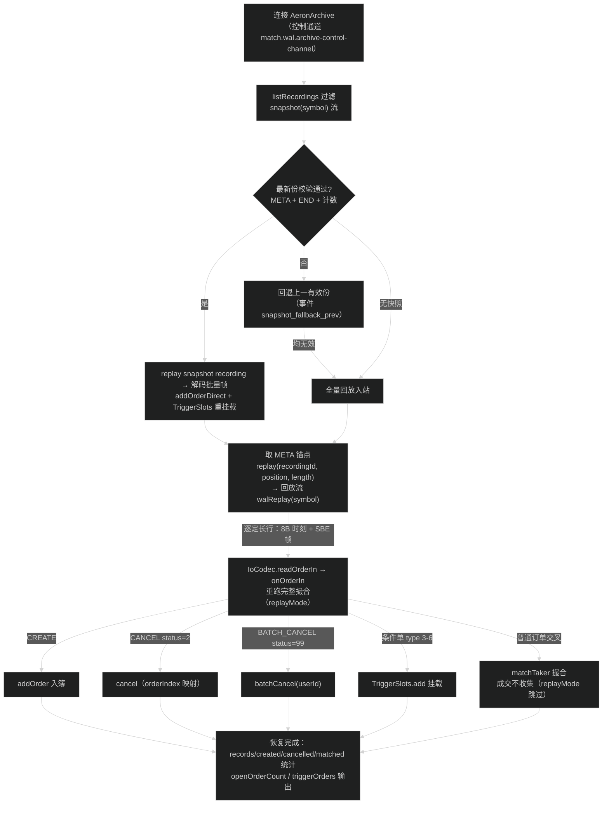
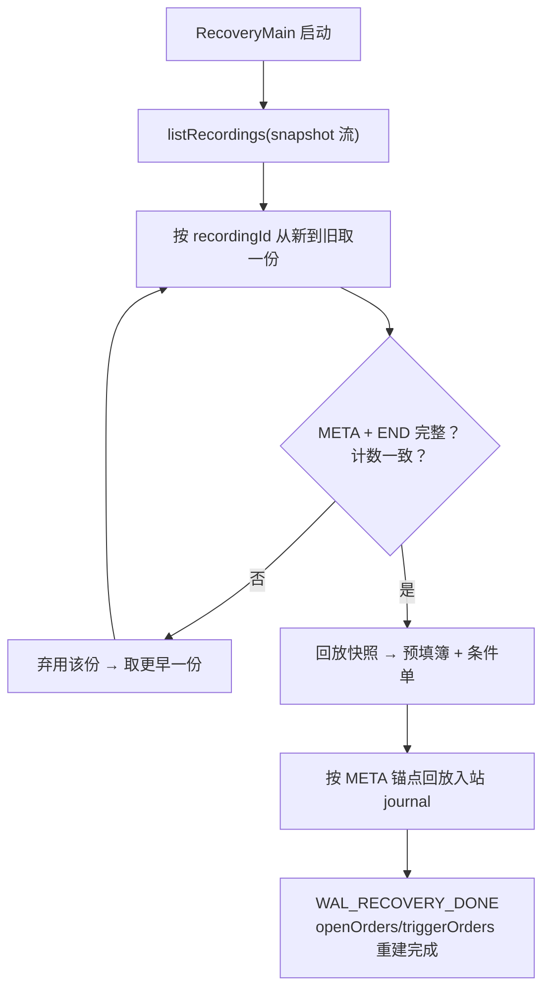

# 崩溃恢复与持久化

> **本章解决**：主机崩溃后如何从「快照 + 入站 journal」把状态追回来。
> **前置依赖**：02（orderId）、05（入站 journal）、04（standby 演练）。
> **读者前置**：快照 / 锚点。

## 1. 持久化与崩溃恢复

### 1.1 输入 journal（唯一日志；archiveWal 已退役）

崩溃恢复的**唯一事实来源 = 入站 journal**（2026-08-29 重构，对齐 LMAX/Aeron
「journal 输入而非内部状态变更」）：`OcxArchiveMain` 对每 symbol 的入站流
`StreamIds.inbound(symbol)` 持续 `startRecording`；恢复时从该 recording 回放输入帧、
**重跑完整撮合逻辑**重建订单簿状态，不再回放状态变更日志。

- **入站 journal**（恢复主路径）：ingress（或裸跑 producer）发布的定长行
  （8B 收单时刻 + SBE 帧，264B）被 Archive 连续记录；崩溃恢复 = 快照（若有）预填
  + 从快照锚点增量回放入站帧，逐帧走 `OrderEventHandler.getEngine().onOrderIn`
  完整撮合（回放期间置位 replayMode：跳过成交收集，重建期间不重复下发成交/深度）；
- **状态变更 WAL（archiveWal）已退役**：2026-08-29 删除 `AeronWalHook` /
  `TYPE_WAL_BATCH` 编码 / `WalJournalThread` 装配，撮合线程不再发布任何状态变更
  日志（JFR 热点 `appendWal*` 整体消失，8M 精确打满，§1.5/10-performance.md §1）。历史已录的
  `archiveWal` recording 仅保留审计价值（`StreamIds.archiveWal` 常量保留，
  防止流号复用破坏历史 recording 归属）；
- **快照（2026-08-30 起为 Aeron Archive recording，Chronicle 目录已删）**：
  撮合线程批末经 `SnapshotCoordinator` 单遍**冻结**（默认 10s，
  `-Docx.snapshot.interval-ms`；实测撮合线程冻结 ~10-20ms，零分配），交接给
  `SnapshotWriter` 快照线程——编码为 OCX1 批量帧发布到 `snapshot(symbol)` 流
  （**2026-08-31 方案 A：快照流由 Archive 常驻录制**——`OcxArchiveMain` 启动时
  startRecording，不再每张 start/stop；运行中临时 startRecording 会踩 Aeron
  available-image 回调缺陷，recording 不创建，见 10-performance.md §1.9）。每张快照 =
  `BEGIN(seq)+META+ORDER+STOP+END` 分段；快照写成功后回收入站 journal 锚点前段；
  快照段级回收（保留最近 N 段）为 TODO（当前常驻累积）。快照内容 = **完整应用状态**
  （对齐 Aeron Cluster 规范：快照必须覆盖全部服务状态，恢复 = 快照 + 锚点后重放 log，
  无状态变更 WAL）：当前簿（单遍枚举 + ORDER 记录，`OrderRecordCodec` OCX1 SBE 负载）+
  **在挂条件单**（triggerCount + STOP 记录：triggerOrderType/triggerPrice/trailDelta
  复用 OrderCreate schema 现成字段，`TriggerSlots.snapshotTriggers` 枚举 8 触发价表 + trailing 链）。
  **写安全（对齐 Aeron Cluster BEGIN/END marker 规范）**：消息序列 = BEGIN(seq) →
  META → ORDER/STOP 批量帧 → END（携带订单/条件单计数）；恢复端按段校验
  END + 计数，取最新有效段（无 END/计数不符该段弃用、回退更早段），杜绝
  「META 正常 + 订单残缺」的静默错。

### 1.2 快照锚点（2026-08-29 位置语义；2026-08-30 随 recording 迁移）

快照 META 记录携带 `inboundRecordingId` + `inboundPosition`（入站 recording 锚点）：

- `walRecordingId` = 入站流**最新一条 recording**（按 recordingId 取最大，含其
  sessionId）；
- `walPosition = min(入站 image 消费字节位置, recorder 已录字节位置)`——二者同处
  **入站流的 Aeron position 字节空间**（跨 term 单调递增），直接取 min，**不做
  行数→字节换算**（IPC 帧头/对齐使 recording 每 264B 行推进 320B，行数换算脆弱）；
  入站 image 位置经 `AeronOrderInSource.imagePositions()` 在**撮合线程冻结时刻**
  采集（sessionId → 位置映射），快照线程按 recording 的 sessionId 精确匹配；
- 崩溃窗口：recorder 落后于撮合消费的字节区间（min 的左侧）不在 recording 内，
  属不可避免的丢失窗口，由快照 + 回放兜底语义覆盖；
- 恢复侧：`recordingId < 锚点` 的旧 recording 整体跳过（快照已覆盖）；
  `== 锚点` 的从 `max(startPosition, walPosition)` 回放；`> 锚点` 的全量回放。

### 1.3 条件单（TriggerSlots）快照——恢复敏感区（2026-08-29）

未触发条件单是恢复的高危状态：交易所明文规定「未触发的 stop order 保持活跃」，
Binance trailing stop 故障后即靠完整快照 + 日志重放恢复。此前快照只枚举
`book.forEachOrderFields`（普通在簿订单），**待触发条件单在崩溃恢复后会静默丢失**
——恢复结果「看起来正常、实际状态错」，比显式失败更危险。

本次补齐：`SnapshotCoordinator` 冻结时经 `TriggerSlots.snapshotTriggers` 单遍枚举，
STOP 记录与 ORDER 记录同一 snapshot recording（2026-08-30 起为 Aeron recording；
恢复端 `SnapshotCodec` 解码 STOP 批量帧）；
`RecoveryService` 恢复时逐条 `TriggerSlots.add` 重挂载（直接反序列化，不重走入站
校验/撮合）。至此快照 = 完整应用状态，**状态变更 WAL（archiveWal）2026-08-29 已
整体退役**（`AeronWalHook`/`TYPE_WAL_BATCH`/`WalJournalThread` 全部删除，历史
recording 仅审计）。

### 1.4 恢复流程（RecoveryService.recover）



恢复全程无 `Order` 对象；入簿/撤单按 orderIndex 映射 + freelist 确定性落位
（02-data-structure.md §1.3，2026-09-01 续）；recording 未停止（活跃）时 `stopPosition` 为 NULL_POSITION，回退
`getRecordingPosition` 取当前录制位置；回放终止双条件：静默判定（2s 无新帧，
`REPLAY_QUIET_MS`）或 30 分钟安全截止（`REPLAY_DEADLINE_MS`，防超大 recording
全量回放失控）。

快照加载 = 按 recordingId 从新到旧**回放校验**（META + END + 计数，§1.1 写安全）：
最新份缺失/校验失败时回退上一有效 snapshot recording（锚点更旧、回放范围更大，
语义不变，事件 `snapshot_fallback_prev`）；均不可用则全量回放入站。

### 1.5 验证记录（2026-08-29：条件单快照 / archiveWal 退役 / 上限探顶）

`stress-test.sh --local --bare-core --big --wal-recover-check`（stop-ratio 2% 条件单流、
快照 10s、入站录制 11.2GB）：

- `RecoveryMain` 恢复：快照预填 `openOrders=1,813,270` + `triggerOrders=177,054`
  （条件单全部重挂载），锚点后增量回放 4,996,000 帧；
- **archiveWal 退役验证（2026-08-29）**：同一 `--wal-recover-check` 全形态复跑
  （产物 `/tmp/perf-nowal-recover`），ArchiveProbe 只剩 1 条 recording
  （inbound 流 11.2GB；对照 WAL 时代基线 `/tmp/perf-stop-snapshot2` 为 archiveWal +
  inbound 共 2 条）；`RecoveryMain` 恢复：快照预填 + 锚点后增量回放
  4,996,232 帧（与 WAL 时代 4,996,000 一致），`openOrders=1,750,925` +
  `triggerOrders=174,004`，**WAL_RECOVERY_DONE**；
- 8M 上限对照（无 journal、关快照）：**`8,000,000` 精确打满**（卸载 WAL 后
  7,757,457 → 8,000,000，引擎仍有余量；随后 9M/10M 探顶封在 ≈8.5M，
  见 10-performance.md §1.7）；
- JFR 热点（`/tmp/perf-nowal-8m/core.jfr`）：decode 912 / onOrderIn 编排 781 /
  matchTaker 723 / Aeron poll 510 / TriggerSlots.checkAndTrigger 268——**appendWal 系列
  已彻底消失**；TriggerSlots.forEach 未进入撮合热路径（仅快照线程低频调用）。

**2026-08-30 验证（快照迁往 Aeron Archive recording，Chronicle 删除）**：
完整形态 5.5M 目标 + `--wal-recover-check`（产物 `/tmp/perf-full-55-snap`）：

- ArchiveProbe 可见 snapshot 流（307916）2 份已停 recording（各 ~144MB，
  start/stopPosition 落定；更早份已被保留策略 purge）；
- `RecoveryMain` 恢复：回放最新 snapshot recording 预填 + 锚点后增量回放
  6,939,450 帧入站，`openOrders=277,972` + `triggerOrders=19,722`，**WAL_RECOVERY_DONE**；
- JFR（`/tmp/perf-full-55-snap/core.jfr`）：快照相关采样仅 7 次（4 张快照，
  撮合线程冻结实测 ~10-20ms/张）；`snapshot-writer` 线程承担编码/发布/回收；
  撮合线程热点不变（matchTaker/decode/removeSlot），**不再有 Chronicle 写入
  （CommonMappedBytes/forEachOrderFields 停摆）**。

### 1.6 文件管理与保留

- 入站 journal 与成交/深度/DLT recording 均落在 Archive 目录（`-Docx.archive.dir=`，
  默认 `aeronDir/archive`），同目录生命周期；压测脚本每轮整体清空；
- **快照后段回收（2026-08-29 落地，2026-08-30 移入快照线程，对齐 Aeron Cluster
  「快照完成后删旧 log segment」）**：快照写成功后（`SnapshotWriter`）——锚点之前
  的整条旧 recording 用 `archive.purgeRecording` 删除（catalog 置 DELETED + 删全部
  段文件，仅限已 stop 的旧 recording）；锚点 recording 用 `archive.purgeSegments`
  删除锚点所在段之前的段（Aeron 要求 purge position 为段边界，用
  `AeronArchive.segmentFileBasePosition` 向下对齐；锚点段保留供增量回放）。磁盘水位
  ≈ 锚点段（≤ segmentFileLength，默认 128MB）+ 快照周期增量，与总时长解耦；回收
  失败仅上报 `purge_*_failed` 事件，下次快照重试；
- **快照 recording 保留（2026-08-31 常驻 recording 分段）**：快照流由 Archive
  常驻录制（`OcxArchiveMain` 启动时 startRecording），每张快照 =
  `BEGIN(seq)+META+ORDER+STOP+END` 分段；恢复/对账端从新到旧逐段校验，取最新
  有效段（无 END/计数不符该段弃用、回退更早段）——语义等价旧 `{symbol}.prev`
  回退，介质统一为 Archive。**快照段级回收（2026-08-31 落地）**：`SnapshotWriter`
  记录每张快照段起点，写完后用 `archive.purgeSegments` 删除最老保留段起点之前的
  段（`segmentFileBasePosition` 对齐段边界，与入站 journal 锚点段回收同套路），
  保留最近 **2 段**（对齐旧"保留 2 份"语义）；300s 完整形态快照 recording 从
  常驻累积压到 ~774MB，恢复验证 WAL_RECOVERY_DONE。
- **长跑水位实测（2026-08-30）**：5.5M × 600s 完整形态入站 recording 全程写了
  ~310GB，快照后段回收把保留水位压在 **~754MB**（锚点段 + 周期增量，与总时长解耦）；
  对照关快照形态 300s 即留 **175GB**——磁盘水位设计依赖快照周期触发回收，快照
  不可随便关闭（详见 10-performance.md §1.9）。
- **保留策略**：`match.wal.retention-days`（默认 3）保留为总账兜底（异常期 Archive
  目录整体保留），正常水位由快照后段回收控制；连续 recording 的 stop/start 轮转
  仍为后续工作（需 `extendRecording` 配套，避免轮转造成 recording 间隙丢事件）；
- Archive `-Docx.archive.file.sync.level=`（0=NO_SYNC/1=SYNC/2=FSYNC，默认 0）——
  持久性窗口与旧 Chronicle 异步 fsync 语义对齐，生产可按需上调；
- 入站 journal 吞吐成本：2026-08-29 实测每 264B 行在 recording 中占 320B
  （IPC 帧头 + 对齐），全形态录制 ≈ 1.6GB/s @5M TPS，是全链路上限的瓶颈（10-performance.md §1.6）。
- 压测产物按轮清理：`/tmp/perf-*` 用后即删（不保留历史 recording/JFR），
  文档中出现的产物路径均为当时记录、非现存文件。

---

---
## 2. 实现详解：恢复三步走查

凌晨 3 点，主机 core 进程被 `kill -9`（模拟断电/崩溃）。Archive 进程和媒体驱动
还在，磁盘上躺着两类东西：**journal recording**（入站每一帧的持久化副本）和
**snapshot recording**（最近一次把「完整簿 + 条件单」编码成的快照段，每张带 META
含锚点 inboundRecordingId + position）。恢复分三步：

1. **找一份可信快照**：`RecoveryService.recover` 列 snapshot 流的 recording，从新到
   旧找**有效份**——快照段必须首条 META、尾条 END、计数一致；中途崩溃致 END 缺失/
   计数不符则弃用、回退上一份（事件 `snapshot_fallback_prev`）。
2. **快照预填**：回放选中快照，ORDER 记录 `addOrderDirect` 预填簿、STOP 记录重挂条件单
   （含 8 触发价表 + trailing 链，§1.3 敏感区）。预填后内存 =「快照那一刻」的完整撮合态。
3. **锚点后重放**：按 META 锚点（min(撮合消费位置, 录制已落位置)）把之后的 journal 逐帧
   喂给同一个确定性入口 `OrderEventHandler.onOrderIn`，撤单/批撤/条件单触发按原顺序
   重跑，直到 journal 结尾。



**快照数字案例（D32 实测量级）**：META 声称订单数 **436,528**、条件单 **1,048,576**，
锚点 =「入站 recording#3 @ 位置 419,495,114,240」；恢复端先回放 ORDER/STOP 预填，再从
锚点继续回放 journal。END 丢失或计数对不上，整段作废回退上一份——宁可多回放，也不信
残缺状态。

## 3. 可执行验证

```bash
# 从 ocx-match-bench/scripts 执行（引擎停止后、driver+archive 仍在时自动跑
# RecoveryMain + 锚点对账）
./stress-test.sh --big --tps 1500000 --duration 120 --heap 6g --cap 5000000 \
  --fund-users 100 --wal-recover-check --no-prom --no-sidecar \
  --prop -Docx.snapshot.interval-ms=60000
```

期望：`wal-recovery.out` 出现 `WAL_RECOVERY_DONE`（打印重建后 openOrders/triggerOrders，
无 decodeFail/校验错）；`trade-recon.out` 出现 `RECON_PASS`（锚点后窗口 U1/U2/U4/U5
全零）；想看快照回退路径，把最新快照 recording 人为截断/损坏后再跑，观察
`snapshot_fallback_prev`。

## 4. 常见误解

- **误解**：恢复 = 重放全部历史 journal，越跑越慢。
  **实际**：快照把回放起点推到锚点，恢复只重放「快照之后 ≈ 一个快照周期」的 journal；
  journal 老段被快照后段回收，磁盘水位与总时长解耦（D 系列 600s 长跑验证）。
- **误解**：`--wal-recover-check` 是真的 kill -9 后测的。
  **实际**：脚本路径是「停 egress 后离线回放」，验证恢复机制本身；真崩溃场景由
  standby 故障演练覆盖（04-ha.md §7 故障接管实验），两者读同一套 snapshot + journal。

代码锚点：`ocx-match-core/.../match/RecoveryService.java`、`SnapshotWriter.java`、
`SnapshotCodec.java`、`StreamIds.java`。


