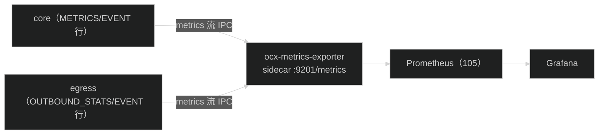
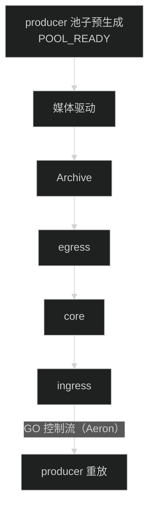

# 可观测性与部署配置

> **本章解决**：如何观测引擎、如何部署配置五个进程。
> **前置依赖**：01（五进程拓扑）。
> **读者前置**：Prometheus / Grafana。

## 1. 可观测性

### 1.1 指标通道



- 2026-08-30 起指标走 **Aeron metrics 流直连 sidecar**（Chronicle metrics 队列已删）：
  core 每 5s 发 METRICS 行（含 JVM）+ 关键事件 EVENT 行；egress 每 2s 发出站统计
  OUTBOUND_STATS 行（发布字节/背压）+ egress 事件；ingress 指标仍经 ingressMetrics
  流合流进 core（`ingress-metrics-source`，语义不变）；
- sidecar 订阅各 symbol 的 `metrics(symbol)` 流，暴露 Prometheus 文本；判活看
  `match_engine_up`（stale 10s 置 0）；sidecar 常驻，媒体驱动晚起时每秒重试建连；
- 引擎零业务日志（`slf4j-nop`），stderr 仅兜底就绪标记与 JVM 未捕获异常。

### 1.2 关键指标

| 指标 | 含义 |
| --- | --- |
| `match_engine_up` / `match_engine_overloaded` | 存活 / 过载 |
| `match_consumer_lag` | 入站 IPC 环积压（发布−订阅位置） |
| `match_throughput_current` / `match_trades_total` | 吞吐 / 累计成交 |
| `match_order_book_size` / `match_order_book_buy_orders` / `sell_orders` | 在簿 / 买卖挂单数 |
| `match_outbound_published_bytes_total` | egress → Archive 累计发布字节（rate 看吞吐） |
| `match_outbound_backpressure_total` / `match_egress_backpressure_total` | 出站环 / Archive 背压 |
| `match_engine_events_total` | 关键事件（快照/恢复/出站/背压/DLT） |
| `jvm_memory_used_bytes` / `jvm_gc_pause_*` | JVM 内存与 GC |

### 1.3 Grafana

撮合引擎面板（open-cex-ops/dashboards/撮合引擎.json）覆盖：TPS、消费积压、P99、
拒绝、盘口深度（买/卖档位数）、在簿买单/卖单、出站发布量、出站背压、引擎存活/
过载、JVM Heap/GC、核心异常事件（5m）。

---
## 2. 配置与部署

### 2.1 关键配置项

```text
# 收单
-Docx.ingress.aeron.udp.endpoint=0.0.0.0:11000        # ingress UDP 收单端点（每 symbol 一流）
# 传输（全部进程共享同一媒体驱动目录）
-Docx.aeron.dir=/tmp/ocx-aeron                         # 媒体驱动目录
-Docx.archive.dir=<aeronDir>/archive                   # Archive 记录目录
-Daeron.socket.so_rcvbuf=8388608                       # UDP 接收缓冲（600K pps 调参）
-Daeron.socket.so_sndbuf=8388608
-Daeron.rcv.initial.window.length=4194304
# 录制 / 快照
-Docx.archive.record-inbound=true                     # 入站 journal 录制开关（OcxArchiveMain；false 跳过录制，压测对照用）
-Docx.archive.record-outbound=true                    # 出站 recording 开关（成交/深度/DLT；false + record-inbound=false + snapshot=0 = 零落盘纯计算形态，2026-08-31）
-Docx.snapshot.interval-ms=10000                      # 快照周期 ms（0=关闭快照，压测对照用）；撮合线程只冻结，编码/发布走 snapshot-writer 线程
# 业务
-Dspring.match.symbols.BTCUSDT.coin-scale=8
-Dspring.match.max-open-orders=5000000                 # 订单簿 cap（内存硬闸）
-Dmatch.wal.enabled=true
-Dmatch.wal.data-dir=<内嵌 Archive 目录>               # 仅单 JVM 开发形态内嵌 Archive 用；生产快照/入站 recording 均在 Archive 目录
-Dmatch.wal.archive-control-channel=aeron:udp?endpoint=localhost:8010   # Archive 控制通道（恢复回放）
# sidecar（ocx-metrics-exporter）
--metrics.aeron.dir=<与 -Docx.aeron.dir 相同的媒体驱动目录>   # metrics 流订阅
--metrics.symbols=BTCUSDT                                     # 订阅 symbol 列表
--metrics.profile=spot                                        # Prometheus profile 标签
-Dmatch.metrics.lag-trigger=50000000                   # 过载判定阈值
-Docx.archive.file.sync.level=0                        # 0=NO_SYNC/1=SYNC/2=FSYNC（入站 journal/出站 recording 持久性窗口）
```

### 2.2 启动方式（五进程）



顺序要点：producer 先灌池（引擎未启动，可用满资源）→ 媒体驱动 → Archive → egress →
core → ingress → go 信号 → 注入。停机倒序（egress 先停让 recording 收尾 → 验证 →
ingress/core/Archive/媒体驱动）。详细参数见运行手册。

core 内部启动顺序：先执行 `RecoveryService.recover`（快照预填 + 入站回放重建
簿状态，06-crash-recovery.md §1.4），**恢复成功后才启动 Match-Handler 撮合线程**；Archive 不可达时
记录 `wal_archive_unavailable` 事件后继续（恢复缺口由下一轮快照 + 回放兜底）。

### 2.3 JVM 参数（JDK 21）

```text
core（压测）: -Xms4g -Xmx4g -Xmn2g -XX:+UseG1GC -XX:MaxGCPauseMillis=20 -XX:+AlwaysPreTouch
ingress/egress/archive: -Xms512m -Xmx2g
--add-opens java.base/java.lang.reflect=ALL-UNNAMED
--add-opens java.base/java.nio=ALL-UNNAMED
--add-opens java.base/jdk.internal.misc=ALL-UNNAMED
--add-exports java.base/sun.nio.ch=ALL-UNNAMED
```

固定堆 + AlwaysPreTouch：启动即 pre-touch 物理页，杜绝纵表容量扩张时的动态物理页
分配抖动（LMAX 机械同理心）。

### 2.4 交易对扩展

无动态 HTTP 端点："新增币对 = 新增一个引擎实例"，按 `spring.match.symbols.*` +
`match.wal.data-dir`（单 JVM 形态内嵌 Archive）+ `-Docx.aeron.dir` 隔离；每个 symbol 一个撮合线程，
多 symbol 多实例线性扩展。重启后由快照 + 入站回放恢复（06-crash-recovery.md §1.4）；撮合后事件从
Archive 回放。

---

